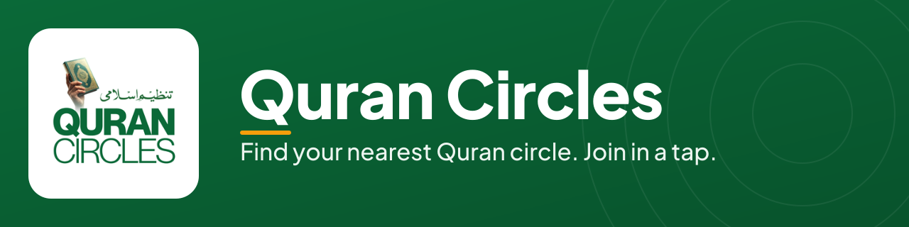
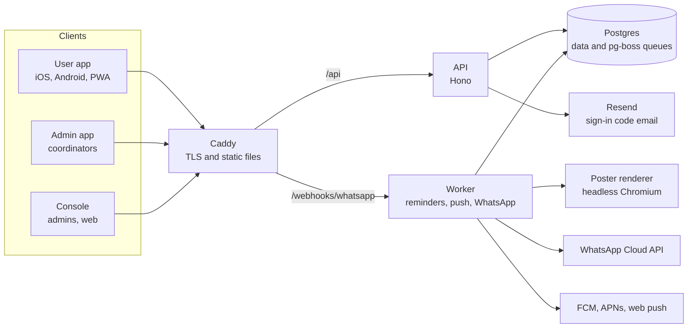

<div align="center">



# Quran Circles

**Find the nearest Quran circle, register in a tap and never miss it. English and Urdu.**

[Web app](https://qurancircle.doraquran.pk) · [Documentation](docs/README.md) · [Member guide](docs/public/content/en/member-guide.md) · [API reference](docs/public/content/en/api-reference.md) · [Getting started](docs/getting-started.md)


</div>

Quran Circles is the platform for Tanzeem-e-Islami's Quran sessions in Pakistan. People find a session near them, join it and get reminders. Coordinators run a venue or circle from their phone. Admins oversee a city or the whole country from a web console. It covers both Dora (the Ramadan and seasonal programme) and Circles (year-round study groups).

## Start here

| I am...                                              | Go to                                                                                                                                                                                                       |
| ---------------------------------------------------- | ----------------------------------------------------------------------------------------------------------------------------------------------------------------------------------------------------------- |
| A member or a coordinator who wants to use the app   | The [member guide](docs/public/content/en/member-guide.md) or the [coordinator guide](docs/public/content/en/coordinator-guide.md). Urdu pages are in [`docs/public/content/ur/`](docs/public/content/ur/). |
| An admin using the web console                       | The [console guide](docs/public/content/en/console-guide.md)                                                                                                                                                |
| A developer who wants to run or change the code      | [Getting started](docs/getting-started.md), then the [repository map](docs/engineering/repo-map.md), [architecture](docs/architecture.md) and [Contributing](CONTRIBUTING.md)                               |
| A partner developer who wants to call the public API | The [API overview](docs/public/content/en/api-overview.md) and the [API reference](docs/public/content/en/api-reference.md)                                                                                 |
| An AI coding agent                                   | [`AGENTS.md`](AGENTS.md), then [`CLAUDE.md`](CLAUDE.md) (it wins if the two differ), your lane's brief in [`docs/agents/briefs/`](docs/agents/briefs/) and the [status files](docs/agents/status/README.md) |
| Releasing the app or deploying the servers           | The [go-live plan](docs/release/go-live.md), the [Play Console steps](docs/release/play-console.md), the [store listing](docs/release/store-listing.md) and the [deployment overview](docs/deployment.md)   |
| Someone who found a security problem                 | The [security policy](SECURITY.md). Do not open a public issue.                                                                                                                                             |

## Screenshots

The user app on a phone, from the current build. The sessions, venues and names are synthetic demo data.

**English**

| Home                                                                                                                                     | Nearby                                                                                                                                               | Session                                                                                                                                 | Quran and prayer                                                                                                               |
| ---------------------------------------------------------------------------------------------------------------------------------------- | ---------------------------------------------------------------------------------------------------------------------------------------------------- | --------------------------------------------------------------------------------------------------------------------------------------- | ------------------------------------------------------------------------------------------------------------------------------ |
| ![Home screen in English: a greeting, the next session card with a Confirm I will join button, and sessions near you this week][en-home] | ![Nearby screen in English: a search box, a Map and List switch, filter chips for Women, Men, Family and Tonight, and a list of sessions][en-nearby] | ![Session screen in English: the start time, a Join button, a reminders note, today's portion and details about the circle][en-session] | ![Quran and Prayer screen in English: a Start reading card for Al-Fatihah, a memorisation card and a list of surahs][en-quran] |

**Urdu (right to left)**

| Home                                                                                                                                                        | Nearby                                                                                                                                | Session                                                                                                                            | Quran and prayer                                                                                                                                    |
| ----------------------------------------------------------------------------------------------------------------------------------------------------------- | ------------------------------------------------------------------------------------------------------------------------------------- | ---------------------------------------------------------------------------------------------------------------------------------- | --------------------------------------------------------------------------------------------------------------------------------------------------- |
| ![Home screen in Urdu, laid out right to left: a greeting, the next session card with a join confirmation button, and sessions near you this week][ur-home] | ![Nearby screen in Urdu, laid out right to left: a search box, a List and Map switch, filter chips and a list of sessions][ur-nearby] | ![Session screen in Urdu, laid out right to left: the start time, a Join button, a reminders note and today's portion][ur-session] | ![Quran and Prayer screen in Urdu, laid out right to left: a Start reading card for Al-Fatihah, a memorisation card and a list of surahs][ur-quran] |

## What it does

- **Nearby circles.** Search and filter sessions by area, venue, section (women, men, family) and time, on a list or a map.
- **One-tap join and reminders.** Join a session, then get a confirmation and reminders before it starts, and a message if the time changes or it is cancelled.
- **Quran reader and prayer times.** Read the Quran with an Urdu translation, bookmark it, and see prayer times and the Hijri date.
- **Coordinator tools.** Run today's session from a phone: registrants, attendance, updates, time changes, the day's portion and posters.
- **Admin console.** Sessions, venues, coordinators, reports, exports, bulk import and an audit log, with every role limited to its own city or venue.
- **English and Urdu.** Every screen works left to right and right to left, at four text sizes, in light and dark.

## How it fits together



One Postgres database, one API and one worker that owns everything that leaves the system. The reasons behind each choice are in [Architecture](docs/architecture.md).

## Repository map

A pnpm monorepo. Each app and package has its own short `README.md`; the full map, with owner lanes and how to test each part, is the [repository map](docs/engineering/repo-map.md).

| Path                   | What it is                                                                |
| ---------------------- | ------------------------------------------------------------------------- |
| `apps/api`             | HTTP API (Hono, TypeScript)                                               |
| `apps/worker`          | Background jobs: reminders, push, WhatsApp, poster renders, daily top-ups |
| `apps/poster-renderer` | Renders session posters and share cards, Urdu in Nastaliq                 |
| `apps/user-app`        | Expo user app (iOS, Android, PWA)                                         |
| `apps/admin-app`       | Expo admin and coordinator app                                            |
| `apps/console`         | React web console for admins (Vite)                                       |
| `packages/contracts`   | Zod schemas, API contract, OpenAPI, scope matrix, message formats, mock   |
| `packages/db`          | Drizzle schema, SQL migrations, seed and first-admin command              |
| `packages/ui`          | Design tokens, the shared component kit and bundled fonts                 |
| `packages/i18n`        | English and Urdu wording for every screen                                 |
| `packages/messaging`   | Providers and fakes for push, WhatsApp, SMS and email; email templates    |
| `packages/content`     | Quran reader, prayer times, Hijri date, bookmarks and reading progress    |
| `tools/`               | Run by hand: V1 migration, circles CSV cleaner, store asset generator     |
| `tests/`               | End-to-end tests and the scope and load runners                           |
| `infra`                | Docker Compose, Caddy, backups, deploy scripts, monitoring                |
| `docs`                 | Product decisions, engineering rules, design, agent briefs, public docs   |

## Quick start

You need Node 22 (see `.nvmrc`), pnpm through Corepack, and Docker for the local database.

```sh
corepack enable
pnpm install
pnpm check                                              # typecheck, lint, tests, format check
```

To run the apps against the contract's mock API, with no database (each command in its own terminal):

```sh
pnpm --filter @qc/user-app mock                          # mock API on http://localhost:4010
EXPO_PUBLIC_API_URL=http://localhost:4010 pnpm --filter @qc/user-app web
pnpm --filter @qc/console dev                            # proxies to the mock by default
```

To run the real API on a local Postgres:

```sh
docker compose -f infra/docker-compose.dev.yml up -d    # Postgres 17 on 127.0.0.1:5432
cp .env.example .env                                    # development-only values, never commit .env
pnpm --filter @qc/db migrate                            # apply the SQL migrations
pnpm --filter @qc/db seed                               # synthetic places, venues and sessions
```

Then start the API and worker as described in [Getting started](docs/getting-started.md), which also covers the poster renderer, the first admin and troubleshooting.

| Command                            | What it does                                                          |
| ---------------------------------- | --------------------------------------------------------------------- |
| `pnpm check`                       | Typecheck, lint, unit tests and format check                          |
| `pnpm test`                        | Unit tests in every package (not end-to-end)                          |
| `pnpm e2e`                         | End-to-end suite (starts its own stack, needs a Postgres)             |
| `pnpm format`                      | Fix formatting with Prettier                                          |
| `pnpm env:check`                   | Check every variable in the `.env.example` files is in `infra/ENV.md` |
| `pnpm --filter <package> <script>` | Run one package's script, for example `pnpm --filter @qc/api test`    |
| `node docs/public/build.mjs`       | Build the public documentation site ([how](docs/public/README.md))    |

**Windows:** the repository is stored with LF line endings and `.gitattributes` keeps them that way on checkout. If an older clone shows hundreds of files changed by `pnpm format:check`, run `git add --renormalize . && git status`, or re-clone.

## Deployment

> **Treat a push to `main` as a deploy to production.** [`docs/deployment.md`](docs/deployment.md) and the CI file record that production runs on [Dokploy](https://dokploy.com), which pulls this repository's `main` branch from GitHub with auto-deploy on. That setting lives in Dokploy, not in this repository, and the owner has stated it; it has not been checked from the repo. Work on a `lane/<lane>/<topic>` branch and merge to `main` only when the change is meant to go live. Run `pnpm check` before you push: CI (`.github/workflows/ci.yml`) is manual only (Actions > ci > Run workflow), never deploys and does not hold a deploy back.

The stack is the Compose file in `infra/` ([deployment overview](docs/deployment.md), runbook in [`infra/README.md`](infra/README.md)). Environment values are set in Dokploy and never committed:

- `.env.example`: development-only values for running the API and worker locally.
- `infra/.env.example`: the template for staging and production, with fake placeholders.
- [`infra/ENV.md`](infra/ENV.md): every variable, who reads it and whether it is required.

## Status

As of 2026-10-26.

- **Built.** Waves 0 to 4 (contracts, every app and service, end-to-end tests, posters, ayah of the day, session companion) are built. Wave 5, hardening, was done except the full restore drill, which needs a production server ([`docs/handoff.md`](docs/handoff.md), 2026-10-18). The apps follow the owner's redesign (D17 in [`docs/design/redesign-decisions.md`](docs/design/redesign-decisions.md)). Sign-in codes go by email.
- **Web app.** `https://qurancircle.doraquran.pk` (no s) is the production address, and its health endpoint answered `{"ok":true,"service":"api"}` when checked on 2026-10-26. The sign-in email sender domain, `qurancircles.doraquran.pk` (with an s), is a different name on purpose ([messaging status](docs/agents/status/messaging.md)); the app does not answer there. The admin console has its own address, which is not published here.
- **Staging.** `staging.doraquran.pk` (user app) and `staging-console.doraquran.pk` (console) run synthetic data and fake messaging.
- **Android.** No Google Play listing is recorded. The first Android build exists and the Play Console steps are still open ([platform status](docs/agents/status/platform.md), [Play Console steps](docs/release/play-console.md)).
- **V1.** The current Nearby Dora Quran web app lives in its own repository, `usmankhan4001/nearby-dora-quran`, and keeps running until the pilot passes ([go-live plan](docs/release/go-live.md)).
- **Wave 6 (pilot and release)** has no gate sign-off recorded in [`orchestrator.md`](docs/agents/status/orchestrator.md); the work toward it is in the go-live plan. Wave 7 (circle requests and demand map) was not started when [`docs/handoff.md`](docs/handoff.md) was written.

**Stale pages.** Several pages were written before production was in use and are out of date on the points below. Where a page and this README differ, trust this README and the code, and expect those pages to be corrected.

- [`docs/handoff.md`](docs/handoff.md), [`docs/deployment.md`](docs/deployment.md) and the [platform status](docs/agents/status/platform.md) still say production is not deployed or not created.
- The [go-live plan](docs/release/go-live.md) names the app host with an s (`qurancircles.doraquran.pk`), which does not serve the app. Use `qurancircle.doraquran.pk`.
- The public API page [`api-auth.md`](docs/public/content/en/api-auth.md) and the generated API reference still describe a sign-in code sent on WhatsApp. The code sends the code by email, and WhatsApp sign-in is off unless `AUTH_PHONE_SIGN_IN=true` is set ([`apps/api/src/auth/config.ts`](apps/api/src/auth/config.ts)).

The lane-by-lane picture is in [`docs/agents/status/`](docs/agents/status/).

## Documentation

The [documentation index](docs/README.md) lists every page by what you are trying to do. The most useful pages:

- [Getting started](docs/getting-started.md): set up, run each app, run the tests.
- [Repository map](docs/engineering/repo-map.md): every folder, its owner lane and how to test it.
- [Architecture](docs/architecture.md): how the parts fit together and why.
- [Deployment](docs/deployment.md): staging, production and backups.
- [Product decisions](docs/product/decisions.md): what is being built. Do not re-decide these.
- [Design](docs/design/README.md): the redesign decisions, the component kit and the screen specs.
- [Public documentation source](docs/public/README.md): the guides and API reference, in English and Urdu, and how they are built.
- [Handoff](docs/handoff.md): where the project stood when it was parked on 2026-10-18, what runs where and what is left.
- [Credits and licences](docs/credits-and-licences.md): fonts, the Quran text and the translations.

## Contributing and security

Branches are `lane/<lane>/<topic>`, each directory has one owner lane, and `pnpm check` must pass before you push. Read [Contributing](CONTRIBUTING.md) first; [GitHub settings](docs/engineering/github-settings.md) and the [branch inventory](docs/engineering/branch-inventory.md) cover the repository settings and which branches can go.

Report a vulnerability privately through the repository's **Security** tab, not in a public issue. See the [security policy](SECURITY.md).

## Credits

The apps bundle Plus Jakarta Sans (SIL OFL 1.1), Jameel Noori Nastaleeq (the owner's copy; its redistribution licence is not confirmed), Mehr Nastaliq Web (CC BY-SA 4.0) and KFGQPC Uthmanic Script HAFS (KFGQPC free-use licence, unmodified), and draw Phosphor icons (MIT). Posters use Figtree (SIL OFL 1.1). The Arabic Quran text comes from the Tanzil Project (CC BY 3.0) and the Urdu and English translations are by Sayyid Abul A'la Maududi, via Tanzil, for non-commercial use. Details are in [Credits and licences](docs/credits-and-licences.md), which at the time of writing still says Jameel is not bundled; the font files are in the repository (`packages/ui/assets/fonts/`), so the owner has to confirm the licence for them.

## Licence

Proprietary. The Quran Circles code belongs to Tanzeem-e-Islami, all rights reserved; it is not open source and may not be copied, used or distributed without written permission. See [`LICENSE`](LICENSE). The bundled fonts and texts keep their own licences. Questions: markaz@tanzeem.org.

[en-home]: docs/assets/screenshots/en-home.png 'English home screen'
[en-nearby]: docs/assets/screenshots/en-nearby.png 'English nearby screen'
[en-session]: docs/assets/screenshots/en-session.png 'English session screen'
[en-quran]: docs/assets/screenshots/en-quran.png 'English Quran and prayer screen'
[ur-home]: docs/assets/screenshots/ur-home.png 'Urdu home screen'
[ur-nearby]: docs/assets/screenshots/ur-nearby.png 'Urdu nearby screen'
[ur-session]: docs/assets/screenshots/ur-session.png 'Urdu session screen'
[ur-quran]: docs/assets/screenshots/ur-quran.png 'Urdu Quran and prayer screen'
