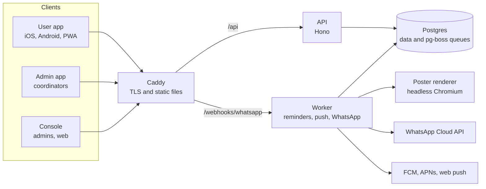

# Quran Circles

Quran Circles helps people in Pakistan find the nearest Quran session, register in a tap and never miss it, and lets coordinators run a venue or circle from their phone. It covers both Dora (the Ramadan and seasonal programme) and Circles (year-round study groups), in English and Urdu.

This repository holds the whole V2 platform: one Postgres database, one API, background workers, a poster renderer, a user app (iOS, Android and PWA), an admin app for coordinators and a web console for admins. V1 (the current Nearby Dora Quran web app) lives in its own repository, `usmankhan4001/nearby-dora-quran`, and stays live until Wave 6 retires it. This repository was split out of V1's `v2/` folder with its history kept.

## Status

**Parked on 2026-10-18.** Start with [HANDOFF.md](HANDOFF.md): what runs where, the state of each wave and the open items.

The build runs in waves (0 to 7) with a quality gate between each. Waves 0 to 4 are built: contracts, every app and service, end-to-end tests and the Wave 4 features (posters, ayah of the day, session companion). Wave 5, hardening, is done apart from a full restore drill on a production server; the low-end phone check passed on 2026-10-18. The apps follow the owner's redesign (D17 in [`docs/design/redesign-decisions.md`](docs/design/redesign-decisions.md)). Staging runs at `staging.doraquran.pk` (user app) and `staging-console.doraquran.pk` (console). Production runs on Dokploy and deploys from `main` (see [Deployment](#deployment)). The final state is tagged `v2-parked-2026-10-18`.

The lane-by-lane picture is in [`docs/agents/status/`](docs/agents/status/), one file per lane, with gate sign-offs in [`orchestrator.md`](docs/agents/status/orchestrator.md).

## What is in it



| Path                   | What it is                                                                | Lane                             |
| ---------------------- | ------------------------------------------------------------------------- | -------------------------------- |
| `apps/api`             | HTTP API (Hono, TypeScript)                                               | api-core, auth-scopes            |
| `apps/worker`          | Background jobs: reminders, push, WhatsApp, poster renders, daily top-ups | messaging                        |
| `apps/poster-renderer` | Renders session posters and share cards, Urdu in Nastaliq                 | renderer                         |
| `apps/user-app`        | Expo user app (iOS, Android, PWA)                                         | user-app                         |
| `apps/admin-app`       | Expo admin and coordinator app                                            | admin-app                        |
| `apps/console`         | React web console for admins (Vite)                                       | console                          |
| `packages/contracts`   | Zod schemas, API contract, OpenAPI, scope matrix, message formats, mock   | contracts                        |
| `packages/db`          | Drizzle schema, SQL migrations, seed and admin bootstrap                  | contracts                        |
| `packages/ui`          | Design tokens, the shared component kit and bundled fonts                 | ui                               |
| `packages/i18n`        | English and Urdu wording for every screen                                 | every lane adds keys; ui reviews |
| `packages/messaging`   | Provider interfaces and fakes for push, WhatsApp and SMS; outbox drafts   | messaging                        |
| `packages/content`     | Quran reader, prayer times, Hijri date, bookmarks and reading progress    | content                          |
| `tools/migration`      | One-off V1 to V2 data migration                                           | data-migration                   |
| `tests/e2e`            | End-to-end tests against a real API, worker and Postgres (Playwright)     | integration                      |
| `tests/load`           | Scope matrix runner and load tests                                        | quality                          |
| `infra`                | Docker Compose, Caddy, backups, deploy scripts, monitoring                | platform                         |
| `tools/store-assets`   | App icon and store screenshot generator (run by hand)                     | release                          |
| `showcase`             | Wraps the `@qc/ui` component catalog into one page for review             | orchestrator                     |
| `docs`                 | Product decisions, engineering rules, design, agent briefs and status     | orchestrator                     |

Each app and package has its own short `README.md`.

## Quick start

You need Node 22 (see `.nvmrc`), pnpm through Corepack, and Docker for the local database.

```sh
corepack enable
pnpm install
pnpm check                                              # typecheck, lint, tests, format check
```

To run the apps against the contract's mock API, with no database:

```sh
pnpm --filter @qc/user-app mock                          # mock API on http://localhost:4010
EXPO_PUBLIC_API_URL=http://localhost:4010 pnpm --filter @qc/user-app web
pnpm --filter @qc/console dev                            # proxies to the mock by default
```

To run the real API on a local Postgres:

```sh
docker compose -f infra/docker-compose.dev.yml up -d    # Postgres 16 on 127.0.0.1:5432
cp .env.example .env                                    # development-only values, never commit .env
pnpm --filter @qc/db migrate                            # apply the SQL migrations
pnpm --filter @qc/db seed                               # synthetic places, venues and sessions
```

Then start the API and worker as described in [Getting started](docs/getting-started.md).

**Windows:** the repository is stored with LF line endings and `.gitattributes` keeps them that way on checkout. If an older clone shows hundreds of files changed by `pnpm format:check`, run `git add --renormalize . && git status`, or re-clone.

## Common commands

| Command                            | What it does                                                                  |
| ---------------------------------- | ----------------------------------------------------------------------------- |
| `pnpm check`                       | Typecheck, lint, unit tests and format check                                  |
| `pnpm test`                        | Unit tests in every package (not end-to-end)                                  |
| `pnpm e2e`                         | End-to-end suite (starts its own stack)                                       |
| `pnpm format`                      | Fix formatting with Prettier                                                  |
| `pnpm env:check`                   | Check every variable in the `.env.example` files is in `infra/ENV.md`         |
| `pnpm branches`                    | List branches merged into `main` (list only; see `scripts/branch-cleanup.sh`) |
| `pnpm --filter <package> <script>` | Run one package's script, for example `pnpm --filter @qc/api test`            |

## Deployment

Production runs on [Dokploy](https://dokploy.com), which pulls this repository's `main` branch from GitHub with auto-deploy on. **A push to `main` deploys to production**, so work happens on `lane/<lane>/<topic>` branches and reaches `main` only when it is meant to go live. CI (`.github/workflows/ci.yml`) checks the code but never deploys and does not hold a deploy back, so protect `main` as described in [GitHub settings](docs/engineering/github-settings.md).

The stack is the Compose file in `infra/` ([deployment overview](docs/deployment.md), runbook in [`infra/README.md`](infra/README.md)). Environment values are set in Dokploy and never committed.

Environment variables:

- `.env.example`: development-only values for running the API and worker locally.
- `infra/.env.example`: the template for staging and production, with fake placeholders.
- [`infra/ENV.md`](infra/ENV.md): every variable, who reads it and whether it is required. `pnpm env:check` fails if an `.env.example` file names a variable that `ENV.md` does not document, and CI runs it.

## Documentation

Start with the [documentation index](docs/README.md). The most useful pages for someone new:

- [Handoff](HANDOFF.md): where the project stopped and what is left.
- [Getting started](docs/getting-started.md): set up, run each app, run the tests.
- [Architecture](docs/architecture.md): how the parts fit together and why.
- [Deployment](docs/deployment.md): staging, production and backups.
- [Contributing](CONTRIBUTING.md): lanes, ownership, branches and the checks a change must pass.
- [GitHub settings](docs/engineering/github-settings.md) and [branch inventory](docs/engineering/branch-inventory.md): repository settings to apply on github.com, and which branches can go.
- [Security policy](SECURITY.md): how to report a vulnerability.
- [Design](docs/design/README.md): the redesign decisions, the component kit and the screen specs.
- [Product decisions](docs/product/decisions.md): what is being built. Do not re-decide these.
- [Credits and licences](docs/credits-and-licences.md): fonts, the Quran text and the translations.

## Credits

The apps bundle Plus Jakarta Sans (SIL OFL 1.1), Mehr Nastaliq Web (CC BY-SA 4.0) and KFGQPC Uthmanic Script HAFS (KFGQPC free-use licence, unmodified), and draw Phosphor icons (MIT). Posters use Figtree (SIL OFL 1.1). The Arabic Quran text comes from the Tanzil Project (CC BY 3.0) and the Urdu and English translations are by Sayyid Abul A'la Maududi, via Tanzil, for non-commercial use. Details are in [Credits and licences](docs/credits-and-licences.md).

## Licence

Proprietary. The Quran Circles code belongs to Tanzeem-e-Islami, all rights reserved; it is not open source and may not be copied, used or distributed without written permission. See [`LICENSE`](LICENSE). The bundled fonts and texts keep their own licences.
