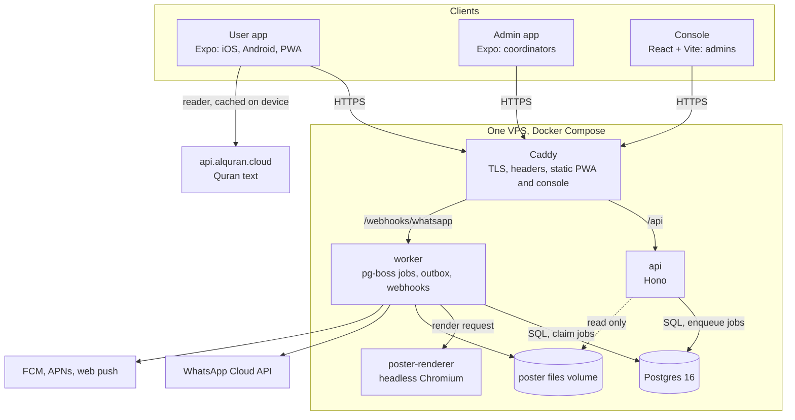

# Architecture

A map of how Quran Circles V2 fits together, for someone reading the code for the first time. The reasons behind each choice are in the decision records under [`engineering/decisions/`](engineering/decisions/README.md); this page links to them rather than repeating them.

## The big picture

- **One database, one API.** Every client talks only to the API over HTTPS. Nothing talks to Postgres except the API, the worker and the migration runner.
- **Queues live in Postgres.** Background work uses pg-boss on the same database, so there is no separate queue service to run.
- **The worker owns everything that leaves the system**: reminders, push, WhatsApp, poster renders. The API only writes rows and enqueues jobs.
- **The poster renderer is isolated.** Only the worker can reach it, on its own internal network with no internet and no database.

## Shared packages: the contract

Everything several parts depend on lives in `packages/` and changes only through its own pull request.

| Package         | What it defines                                                                                                                                                                                                                                         |
| --------------- | ------------------------------------------------------------------------------------------------------------------------------------------------------------------------------------------------------------------------------------------------------- |
| `@qc/contracts` | Zod schemas for every request and response, the endpoint registry (`endpoints.ts`), the generated `openapi.json`, error codes, the role-and-scope matrix (`can`, `scopeFilter`, see `SCOPES.md`), message formats, a typed API client and a mock server |
| `@qc/db`        | The Drizzle schema, the SQL migrations in `migrations/`, the synthetic seed, shared scheduled jobs and `bootstrap-admin`                                                                                                                                |
| `@qc/i18n`      | Every user-facing string in English and Urdu, split into parts so each app loads only its own words                                                                                                                                                     |
| `@qc/ui`        | Design tokens, the theme (light, dark, high contrast, four text sizes, LTR and RTL), the component kit and the bundled fonts                                                                                                                            |
| `@qc/messaging` | Provider interfaces with real and fake implementations for push, WhatsApp and SMS, and the helpers that draft outbox rows                                                                                                                               |
| `@qc/content`   | The Quran reader source and cache, prayer times, the Hijri date, bookmarks and reading progress                                                                                                                                                         |

Apps never import other apps, and packages never import apps. Lint enforces both.

## How a request flows

1. A client calls the API with the typed client from `@qc/contracts`.
2. The API's route binder ([decision 0011](engineering/decisions/0011-api-core-route-binder.md)) runs the same steps for every endpoint: rate limit, sign-in check, parse params, query and body with the contract schemas, authorise, run the handler, then validate the response against the contract before sending it.
3. Handlers never read roles directly. They call `ctx.authorize` or `ctx.scope`, which use `can` and `scopeFilter` from the contract's scope matrix. A staff handler that forgets to decide fails closed, and a test scans the source for direct role checks.

The contract mock (`createMockHandler`) answers the same endpoints, so every app's tests render real screens against it without a network.

## Sign-in, roles and scopes

- **Phone codes** ([decision 0002](engineering/decisions/0002-auth-approach.md)): a six-digit code sent by WhatsApp, with SMS as a fallback. Codes are stored hashed, live five minutes, allow five attempts and are rate limited per number and per address.
- **Tokens**: a 15-minute HS256 access token (no personal data in it) and a refresh token that rotates on every use; reuse signs the device out.
- **Roles**: national admin, city or regional coordinator, venue coordinator. Roles are read from `role_assignments` on every request, so a handover takes effect at once. Attendees have no role; browsing needs no account.
- **Scopes**: what each role may do, and where in the place hierarchy (Country, Province, City, Area, Venue), is one matrix in `@qc/contracts`, reviewed by a human at Gate 1.

## Messaging

[Decision 0005](engineering/decisions/0005-messaging-outbox-and-providers.md). `message_outbox` is the only way a notification leaves the system. Whoever wants to send something inserts a row (with an idempotency key); the worker claims rows, checks consent and spend caps, sends through the provider and records the result (`queued`, `sending`, `sent`, `delivered`, `failed`, `dead`). WhatsApp delivery receipts come back through the worker's webhook. In development and tests `MESSAGING_MODE=fake` swaps every provider for a fake.

## Background jobs

The worker runs pg-boss schedules and queues, all in Asia/Karachi time where it matters:

- reminders before each session occurrence;
- the daily occurrence top-up, which keeps recurring sessions scheduled a set number of days ahead;
- the morning ayah of the day push;
- push fan-out for large updates;
- poster renders (from the API's `poster-render` queue);
- daily sign-in cleanup.

## Posters

[Decision 0012](engineering/decisions/0012-poster-urdu-rendering.md). Coordinators pick a template and fill a few fields; the API validates the request and enqueues a render; the worker calls the renderer, which lays out the poster in headless Chromium with Mehr Nastaliq for Urdu and returns a PNG or PDF (story, A4, A3, link preview). Files go to the poster volume and the API serves them read-only. A poster whose session changed later is marked out of date and can be regenerated.

## Quran and prayer times

- **Quran text** ([decision 0008](engineering/decisions/0008-quran-source-and-cache.md)): fetched from api.alquran.cloud (`quran-uthmani` Arabic, Maududi translations) and cached on the device for up to 24 passages. No Quran text or translation is stored in the repository.
- **Prayer times** ([decision 0007](engineering/decisions/0007-prayer-times-and-hijri.md)): computed on the device with `adhan` (Karachi method, Hanafi Asr), in Pakistan time. The Hijri date uses a vendored Umm al-Qura table plus an admin offset.

## The apps

| App       | Stack                                                      | Decision                                                  |
| --------- | ---------------------------------------------------------- | --------------------------------------------------------- |
| User app  | Expo SDK with expo-router; web output is a single-page PWA | [0009](engineering/decisions/0009-user-app-stack.md)      |
| Admin app | The same stack as the user app, for coordinators on phones | [0010](engineering/decisions/0010-admin-app-stack.md)     |
| Console   | Vite and React Router, plain CSS from the `@qc/ui` tokens  | [0006](engineering/decisions/0006-console-web-tooling.md) |

All three inject their outside dependencies (API client, storage, clock, maps) at the root, so screens are tested with in-memory parts and the contract mock. Styling uses logical properties only, so the same code mirrors for Urdu; a test fails on `left`, `right` or raw colours ([decision 0003](engineering/decisions/0003-ui-tooling.md)).

## Data

The data model is described in [`product/data-model.md`](product/data-model.md) and implemented in `packages/db/src/schema`. Migrations are plain SQL, applied in order by `pnpm --filter @qc/db migrate` locally and by the one-shot `migrate` service on servers. On servers each service uses its own least-privilege database role (`infra/postgres/roles.sql`): the API cannot change the schema, and only the migrator owns the tables.

V1 data is moved by `tools/migration` ([decision 0004](engineering/decisions/0004-v1-migration-approach.md)): one code path for the dry run and the apply, an approval fingerprint, and reports that contain counts only.

## Where to read next

- [Getting started](getting-started.md) to run it.
- [Deployment](deployment.md) for staging, production and backups.
- [`product/`](product/) for what the product does and why.
- [`engineering/decisions/`](engineering/decisions/README.md) for every architecture decision.
